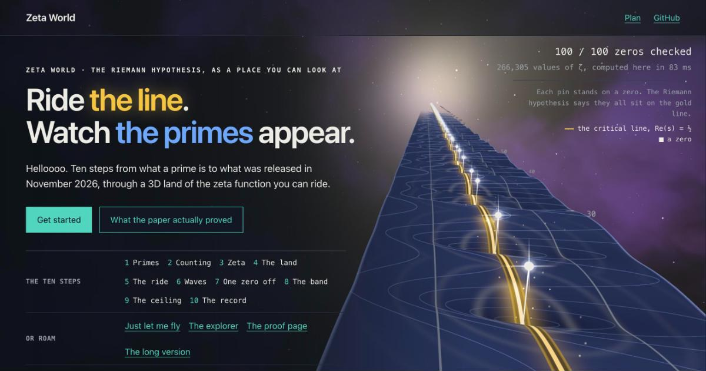

# Zeta World

A way to visualize the Riemann hypothesis in 3D, built with Three.js for Sundai Hack 150 (Building 3D Worlds).

[](https://alex-lop.github.io/zeta-world/)

**Live: https://alex-lop.github.io/zeta-world/** · [From primes to the proof, in 28 steps](https://alex-lop.github.io/zeta-world/learn.html) · [The plan](PLAN.md) · [Brief for the interactive guide](GUIDE_BRIEF.md)

The home page is a guided climb in ten short steps, each with one thing to do:

1. Split a number into its primes.
2. Count the primes against x / ln x.
3. Add the arrows of ζ(s).
4. Look around the land of ζ, where every zero is a well.
5. Ride north up the critical line past the first 100 zeros.
6. Keep riding: each zero passed adds a wave, and spikes rise at the primes.
7. Drag one hypothetical zero off the line, and its mirror twin appears.
8. Add its wave to the primes and watch them leave the band they keep to if every zero is on the line.
9. See where the announced proof's ceiling comes from.
10. Read what was released, what was checked and what is still needed.

The page measures as it goes, in the visitor's browser: how far x / ln x misses the count, how many of the 15 tallest spikes are primes (15 of 15 by the end of the ride), how much of their band the real primes use (49%), and how long the land's 266,305 values of ζ took to compute.

"Just let me fly" (`#fly`) is the plain 3D world with free controls. The look follows Alex's [Nemisis](https://alex-lop.github.io/Nemisis/) site: the 3D world floats in a night sky, and the ticks of his personal site are behind the other screens. The hypothetical zero is fiction and is labelled so wherever it shows.

## Status of the math

As of 22 Nov 2026: a computer-checked proof of the Riemann hypothesis was released on 20 Nov and certified correct on 21 Nov in a [joint statement of the Lean and Mathlib communities](https://leanprover-community.github.io/blog/posts/riemann-hypothesis/). Its author has published it only as Lean code, with no paper yet, and it has not been peer reviewed. In October 2026 a proof of a weaker "quasi-Riemann hypothesis" (no zeros with real part above 7/8) was released, checked in Lean and also not peer reviewed.

More detail: Levent Alpöge announced the proof on 20 November 2026. It covers the Riemann hypothesis and the generalized Riemann hypothesis for Dirichlet L-functions, published as a formal proof in Lean (175,187 files).

- **Machine-checked:** two independent proof checkers (Lean's kernel and NanoDA, written in Rust) accepted the complete proof, and several outside groups report reproducing that. It uses only Lean's three standard axioms, and its final statements match Mathlib's definition of the Riemann hypothesis.
- **Not yet refereed:** there is no human-readable write-up of the argument, and mathematicians have not reviewed it.

This project shows what the hypothesis says: the zeros, the critical line, and how the zeros shape the primes. It proves nothing. For a map of the announced proof and a record of who has checked what, see [riemann-rev](https://github.com/nasqret/riemann-rev) ([site](https://nasqret.github.io/riemann-rev/)).

## Getting started

1. **Understand it first.** What the zeta function is, what its zeros are, what the hypothesis claims about them, and why the primes care.
2. **First picture.** Draw the height of |ζ(s)| over the critical strip (0 < Re(s) < 1) as a terrain, computed in a shader.
3. **Mark the zeros.** Hardcode the first ~100 nontrivial zeros and show them on the line Re(s) = 1/2.
4. **Zeros build the primes.** A slider that adds zeros one at a time and shows the smooth curve turning into the prime-counting staircase (the explicit formula). This is the part that teaches something, so it comes before polish.
5. **Stretch.** Sound for each zero, a marker for the region the quasi-RH result covers, an AI guide that flies the camera to answer a question.

## Stack

Three.js and a plain `index.html` to start. Add a build step only when something needs it.

## Running

ES modules need a server, not `file://`:

```sh
python3 -m http.server 8000   # then open http://localhost:8000
```

- `index.html`: the home page, the guided climb. Its modules are in `guide/`: `guide.js` (the steps), `scene.js` (the 3D world), `zeros.js` and `field.js` (the ticks).
- `landscape.html`: the explorer, with ζ(s)/ξ(s), L(s, χ) and Primes tabs, a movable window up to t = 110, a critical-line probe, and the curve panel. Open http://localhost:8000/landscape.html.

- `zeta.js`: double-precision ζ(s) using the Borwein-accelerated eta series (valid in the critical strip), the completed function ξ(s), Hardy's Z(t), and a zero finder.
- `main.js`: the terrain (ζ, ξ or L(s, χ) computed per vertex in a shader, chosen with tabs and radio buttons), critical-line probe, and the critical-line curve.
- `dirichlet.js`: Dirichlet characters, L(s, χ) via Hurwitz sums with Euler–Maclaurin, the completed Λ(s, χ), and its zeros (the L(s,χ) tab).
- `proof.html`, `proof.js`, `proofMath.js`: a separate page that walks through the strategy of the announced proof in four interactive pictures (mirror, ceiling, one-sided windows, divisibility).
- `step4.html`, `step4.js`: step 4 of the proof in six sub-steps (4a–4f), from divisibility at inert primes to the ½ + 9ε budget. `viz.js` holds the canvas helpers both pages share.
- `primes.js`, `primesView.js`: ψ(x), the explicit formula, and the Primes tab chart (the zeros rebuilding the prime staircase).

See [docs/riemann_graph_v1.md](docs/riemann_graph_v1.md) for how it works, with the math.
